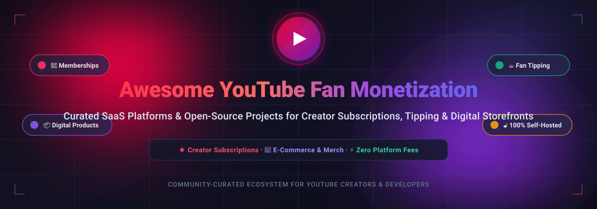

<p align="center">
  <a href="#awesome-youtube-fan-monetization">
    
  </a>
</p>

<p align="center">
  <a href="https://github.com/ishandutta2007/Awesome-Awesome-Awesome"></a><a href="https://discord.gg/jc4xtF58Ve"></a>
  <a href="https://github.com/ishandutta2007/Awesome-Youtube-Fan-Monetization/stargazers"></a>
  <a href="https://github.com/ishandutta2007/Awesome-Youtube-Fan-Monetization/network/members"></a>
  <a href="https://github.com/ishandutta2007/Awesome-Youtube-Fan-Monetization/blob/main/LICENSE"></a>
  <a href="https://github.com/ishandutta2007/Awesome-Youtube-Fan-Monetization/pulls"></a>
  <a href="https://github.com/ishandutta2007"></a>
</p>

---

# 🚀 Awesome YouTube Fan Monetization

> 🌟 **A curated directory of top-tier SaaS platforms and open-source GitHub projects empowering YouTube creators, video podcasters, and digital educators to build recurring fan revenue, sell digital products, collect tips, and escape native platform fees.**

YouTube's native fan funding features (Channel Memberships, Super Chat, Super Thanks) levy a steep **30% platform take-rate** and demand strict eligibility requirements. This repository tracks production-grade **SaaS services** and **self-hostable open-source solutions** that give creators complete direct-to-consumer ownership over their audience, recurring memberships, digital downloads, branded merchandise, and payment streams.

---

## 📑 Table of Contents

- [📊 Sector Overview & Market Dynamics](#-sector-overview--market-dynamics)
- [🏢 SaaS Fan Monetization Platforms](#-saas-fan-monetization-platforms)
- [💻 Open-Source Fan Monetization Projects](#-open-source-fan-monetization-projects)
- [🏗️ Self-Hosted Creator Architecture Stack](#️-self-hosted-creator-architecture-stack)
- [💡 Frequently Asked Questions (FAQ)](#-frequently-asked-questions-faq)
- [🤝 How to Contribute](#-how-to-contribute)
- [📈 Star History](#-star-history)
- [💖 Support](#-support)
- [📜 Disclaimer & License](#-disclaimer--license)

---

## 📊 Sector Overview & Market Dynamics

- **Estimated Market Size**: The global **Creator Economy** is valued at over **$250 billion** and is projected by Goldman Sachs to expand to nearly **$480 billion by 2027**, with the direct-to-consumer **fan-funding and creator monetization** subsector alone representing over **$15–$20 billion** in annual transaction volumes.
- **Market Structure & Fragmentation**: The sector is **moderately fragmented**: category incumbents like **Patreon** and **Kajabi** hold strong brand moats in membership subscriptions and high-ticket digital courses, yet the ecosystem resists winner-take-all capture. High platform take-rates (such as YouTube's 30% cut and traditional 10–20% SaaS fees) have catalyzed rapid adoption of lean link-in-bio storefronts (e.g. Stan Store, Fourthwall) and a fast-growing wave of **self-hosted, open-source software** (Ghost, Medusa, BTCPay Server) offering 0% middleman fees and sovereign audience data.

---

## 🏢 SaaS Fan Monetization Platforms

Below is a detailed comparison of industry-leading SaaS platforms curated for YouTube creators. The table is **sorted descending by Company Size / Valuation / Revenue**.

| 🏷️ Platform | 🏢 Company Size / Valuation / Revenue | 💳 Starting Tier Pricing | 🎁 Free Tier / Free Trial Limits | 🚀 Creator Focus & Capabilities |
| :--- | :--- | :--- | :--- | :--- |
| **[Patreon](https://www.patreon.com/)** | **~$4.0B Valuation** ($150M+ ARR, $413M raised across Series A–F) | **8% flat fee** on Pro plan (+ 2.9% + $0.30 payment processing fee) or 12% on Premium plan | **Free forever plan**: $0/month subscription cost with 8% flat take rate; includes unlimited patrons, patron-only community feeds, multimedia posts, and direct digital commerce | Tiered recurring memberships, patron-exclusive video/audio feeds, community hubs, and direct digital commerce |
| **[Kajabi](https://kajabi.com/)** | **~$2.0B+ Valuation** ($100M+ ARR, $6B+ cumulative creator GMV; majority-owned by Francisco Partners) | **$69/month** (Kickstarter plan, billed annually at $828/yr) or $149/month (Basic plan, billed monthly); 0% transaction fees | **14-day free trial**: Unrestricted access to 1 product, 1 funnel, 250 contacts, 50 active members, and unlimited marketing emails (no permanent free tier) | All-in-one knowledge commerce, video courses, community portals, automated sales funnels, and podcast hosting |
| **[Spring](https://www.spri.ng/)** *(Teespring)* | **~$500M Valuation** (Acquired by Amaze Software; raised $60M+ venture funding) | **$0/month base cost** (Creator profit equals Sale Price minus Fixed Base Manufacturing Cost, e.g. ~$10.50 per standard custom tee) | **Free forever plan**: $0 upfront or monthly platform fees, unlimited custom merchandise designs, automated YouTube Merch Shelf integration, and global print-on-demand fulfillment | Print-on-demand custom apparel, automated global fulfillment, and direct YouTube Shopping shelf integration |
| **[Stan Store](https://stan.store/)** | **~$150M - $200M Valuation** (Leading mobile-first creator link-in-bio storefront; backed by top angels) | **$29/month** (Creator plan) or **$99/month** (Creator Pro plan); 0% platform transaction fees on all tiers | **14-day free trial**: Full access to 1-tap checkout, video course hosting, calendar bookings, digital download delivery, and 0% transaction fees (no permanent free tier) | Mobile-first link-in-bio storefront, video courses, 1-on-1 coaching consultations, and lead capture funnels |
| **[Gumroad](https://gumroad.com/)** | **~$100M Valuation** (Crowdfunded at $100M valuation; $15M+ ARR, $1B+ paid out to creators) | **10% flat fee per transaction** (+ standard credit card fees: 2.9% + $0.30); $0 recurring monthly subscription | **Free forever plan**: $0/month account fee, unlimited digital products, customer email broadcasts, and pay-what-you-want pricing with 10% flat transaction fee applied to all earnings | Digital downloads, PDF guides, software licenses, serialized courses, and subscription newsletters |
| **[Fourthwall](https://fourthwall.com/)** | **~$85M Valuation** (Raised $17M+ from Lightspeed, Initialized Capital, and top YouTube creators) | **$0/month subscription**; charges **5% fee on digital products & memberships** (0% cut on fan tips/donations; physical merch priced per item manufacturing cost) | **Free forever plan**: Custom domain mapping, unlimited physical/digital product listings, video thank-you messages, recurring supporter memberships, and 0% cut on tips | White-label custom creator storefronts, branded apparel, recurring memberships, digital downloads, and YouTube Merch shelf sync |
| **[Fanbase](https://fanbase.com/)** | **~$65M - $85M Valuation** (Raised $11M+ via Reg A+ equity crowdfunding; 600K+ registered creators) | **Free app download**; platform keeps **20% cut on Love micropayments** and **50% split on exclusive subscription channels** (minus app store fees) | **Free forever plan**: Unrestricted profile creation, short-form video publishing, social audio room hosting, and fan tipping; revenue shares apply to subscriber channels | Social network combining short-form video, live audio rooms, micropayment tipping ("Love"), and creator subscriber channels |
| **[Memberful](https://memberful.com/)** | **~$50M - $60M Valuation** (Acquired by Patreon in 2018 as standalone enterprise CMS membership division) | **$0/month on Starter plan** (10% transaction fee) or **$25/month on Pro plan** (4.9% transaction fee + Stripe processing fees) | **Free forever plan (Starter)**: Unlimited members, up to 2 active subscription tiers, private podcast RSS feeds, test-mode payment sandbox, and website embed widgets (10% fee per transaction) | White-label membership plugin for WordPress, Webflow, and custom websites, gated content access, and recurring billing |
| **[Buy Me a Coffee](https://buymeacoffee.com/)** | **~$40M - $50M Valuation** (Bootstrapped & profitable; 1M+ creators; over $100M processed in creator payouts) | **5% flat transaction fee** on all tips, recurring memberships, and shop sales ($0 recurring monthly subscription) | **Free forever plan**: Full platform access with $0 monthly fee, unlimited supporters, one-time donation buttons, custom monthly/yearly membership tiers, digital shop, and Discord role integration; 5% flat fee on earnings | Frictionless fan tipping, recurring memberships, digital shop extras, direct payouts via Stripe/Wise, and creator links |
| **[Ko-fi](https://ko-fi.com/)** | **~$30M - $40M Valuation** (Bootstrapped & profitable; 1.5M+ creators; over $250M processed for creators) | **$0/month on Free tier**; optional Ko-fi Gold at $6/month (billed annually at $72/yr) or $8/month (billed monthly) for 0% commission on shop/commissions | **Free forever plan**: **0% platform fee on one-time donations/tips**, 5% fee on commissions, digital shop sales, and recurring monthly memberships; includes crowdfunding target widgets | Zero-fee tip jar, commission requests, crowdfunding target goals, recurring memberships, and supporter-only galleries |

---

## 💻 Open-Source Fan Monetization Projects

A curated collection of self-hosted, open-source repositories enabling creators and developers to build custom membership portals, payment processors, tipping pages, and digital storefronts without recurring SaaS subscriptions or platform lock-in.

*Sorted descending by GitHub_Stars_Count:*

- **[Ghost](https://github.com/TryGhost/Ghost)** [](https://github.com/TryGhost/Ghost/stargazers)  
  *The premier open-source publishing and membership platform.* Features native member registration, Stripe integration for tiered paid subscriptions, gated post content, and automated email newsletters. Powers hundreds of thousands of independent creators and media brands seeking complete data ownership with zero platform cuts.

- **[Hyperswitch](https://github.com/juspay/hyperswitch)** [](https://github.com/juspay/hyperswitch/stargazers)  
  *High-performance, open-source payment switch written in Rust.* Orchestrates multi-gateway routing (Stripe, PayPal, Adyen, Apple Pay, crypto) for creator storefronts and membership platforms, optimizing payment success rates and slashing payment processing fees.

- **[Medusa](https://github.com/medusajs/medusa)** [](https://github.com/medusajs/medusa/stargazers)  
  *Modular open-source headless commerce engine built with Node.js and TypeScript.* Provides a customizable backend for selling creator merchandise, digital assets, and recurring subscription products with extensible plugin architecture.

- **[Bagisto](https://github.com/bagisto/bagisto)** [](https://github.com/bagisto/bagisto/stargazers)  
  *Enterprise Laravel-based open-source e-commerce framework.* Includes built-in multi-currency, multi-channel capabilities, and downloadable digital product catalogs, ideal for creators building branded e-commerce stores with total code ownership.

- **[Saleor](https://github.com/saleor/saleor)** [](https://github.com/saleor/saleor/stargazers)  
  *Ultra-fast, composable headless e-commerce platform powered by Python, Django, and GraphQL.* Allows creators and engineering teams to deploy performant digital storefronts, member-only merchandise drops, and seamless checkout flows.

- **[Spree Commerce](https://github.com/spree/spree)** [](https://github.com/spree/spree/stargazers)  
  *Time-tested open-source headless commerce platform written in Ruby on Rails.* Highly adaptable for creators selling digital guides, preset packs, physical apparel, and tiered subscriptions with zero platform commissions.

- **[Vendure](https://github.com/vendurehq/vendure)** [](https://github.com/vendurehq/vendure/stargazers)  
  *Modern headless commerce framework built on TypeScript, NestJS, and GraphQL.* Purpose-designed for developer ergonomic flexibility, making it easy to create customized subscription billing, video course checkouts, and downloadable content portals.

- **[BTCPay Server](https://github.com/btcpayserver/btcpayserver)** [](https://github.com/btcpayserver/btcpayserver/stargazers)  
  *Self-hosted, open-source cryptocurrency payment gateway.* Allows YouTube creators to accept direct Bitcoin and Lightning Network tips, recurring donations, and crowdfunding contributions directly to their non-custodial wallets with **0% fees and no middleman censorship**.

- **[Kill Bill](https://github.com/killbill/killbill)** [](https://github.com/killbill/killbill/stargazers)  
  *Industrial-grade open-source subscription billing and payments platform.* Manages complex recurring pricing models, automated dunning routines, invoice generation, and multi-gateway payment processing for scalable creator platforms.

- **[Liberapay](https://github.com/liberapay/liberapay.com)** [](https://github.com/liberapay/liberapay.com/stargazers)  
  *Recurrent donation and patronage platform built specifically for creators, artists, and open-source contributors.* Operates as a transparent non-profit charging **0% platform fees**, funded entirely through voluntary donations on its own system.

- **[FOSSBilling](https://github.com/FOSSBilling/FOSSBilling)** [](https://github.com/FOSSBilling/FOSSBilling/stargazers)  
  *Lightweight, open-source billing and client management software.* Features recurring invoice generation, client portal accounts, and multi-gateway checkout modules suited for creator consulting services and premium content tiers.

- **[Open Collective](https://github.com/opencollective/opencollective-frontend)** [](https://github.com/opencollective/opencollective-frontend/stargazers)  
  *Open-source transparent funding and patronage framework.* Enables creator collectives, community video projects, and developer groups to collect recurring contributions from fans with an open financial ledger.

- **[Cloud Patron](https://github.com/cloudpatron/cloudpatron)** [](https://github.com/cloudpatron/cloudpatron/stargazers)  
  *Self-hosted open-source Patreon alternative.* Provides subscription-based recurring creator funding, tiered supporter content feeds, and direct backer management without platform revenue cuts.

- **[Mirlo](https://github.com/funmusicplace/mirlo)** [](https://github.com/funmusicplace/mirlo/stargazers)  
  *Open-source audio distribution and patronage platform.* Built for musicians, podcasters, and YouTube audio creators to release tracks, host subscriber-only audio feeds, and receive direct community patronage.

- **[Open Payment Host](https://github.com/abishekmuthian/open-payment-host)** [](https://github.com/abishekmuthian/open-payment-host/stargazers)  
  *Self-hosted payment and subscription gateway written in Go.* Supports Stripe, Square, PayPal, and Razorpay with webhook routing, allowing creators to drop a standalone payment checkout into any personal website.

- **[Patron](https://github.com/patroninc/patron)** [](https://github.com/patroninc/patron/stargazers)  
  *Open-source Patreon alternative built for serial content creators.* Features **rolling paywalls** where newly released episodes, chapters, or videos start gated to paying supporters and automatically release to the public on a configurable schedule. Built in Rust and React.

- **[MemberMatters](https://github.com/membermatters/MemberMatters)** [](https://github.com/membermatters/MemberMatters/stargazers)  
  *Open-source membership and automated billing portal.* Built with Django and Vue.js with integrated Stripe recurring payments, self-service member dashboards, single sign-on (SSO), and access control hooks.

- **[Createon](https://github.com/opd-ai/createon)** [](https://github.com/opd-ai/createon/stargazers)  
  *Self-hosted crypto Patreon alternative in Go.* Enables creators to accept direct Bitcoin and Monero payments. Features a flat-file architecture requiring no database, tier-restricted Markdown content, and automated cryptographic payment verification.

- **[Open Creator Rails](https://github.com/ChainSafe/open-creator-rails)** [](https://github.com/ChainSafe/open-creator-rails/stargazers)  
  *Decentralized paywall and subscription infrastructure built under contract for the Ethereum Foundation.* Grants instant on-chain access control and direct wallet-to-creator streaming payments without third-party gatekeepers.

- **[NestMembership](https://github.com/ozardali/NestMembership)** [](https://github.com/ozardali/NestMembership/stargazers)  
  *Lightweight membership and subscription backend built with NestJS and PostgreSQL.* Features user authentication, customizable subscription plans, and recurring payment webhook handlers for Stripe and Paddle.

---

## 🏗️ Self-Hosted Creator Architecture Stack

For engineering-minded creators wishing to deploy a 100% self-hosted, sovereign monetization pipeline:

```
┌────────────────────────────────────────────────────────┐
│           YouTube Video & Description Links            │
└───────────────────────────┬────────────────────────────┘
                            │
               ┌────────────┴────────────┐
               ▼                         ▼
┌─────────────────────────────┐ ┌─────────────────────────────┐
│  Content & Membership Hub   │ │   Merch & Digital Store     │
│   (Ghost / MemberMatters)   │ │      (Medusa / Bagisto)     │
└──────────────┬──────────────┘ └──────────────┬──────────────┘
               │                               │
               └──────────────┬────────────────┘
                              ▼
┌─────────────────────────────────────────────────────────────┐
│            Payment Orchestration & Routing                  │
│     (Hyperswitch / Open Payment Host / BTCPay Server)       │
└─────────────────────────────┬───────────────────────────────┘
                              ▼
┌─────────────────────────────────────────────────────────────┐
│      Settlement: Direct to Bank / Sovereign Crypto Wallet   │
│                 (0% Platform Commission)                    │
└─────────────────────────────────────────────────────────────┘
```

---

## 💡 Frequently Asked Questions (FAQ)

### ❓ Why should YouTube creators use third-party fan monetization tools?
YouTube retains **30% of all Channel Membership, Super Chat, and Super Thanks revenue**, alongside withholding local taxes and enforcing minimum payout thresholds. Third-party SaaS platforms typically charge between 0% and 10%, while self-hosted open-source software charges **0% platform fees**, allowing creators to retain up to 95–97% of net income after standard credit card interchange fees.

### ❓ Can I link these platforms directly from my YouTube channel?
Yes. Creators can add links to Patreon, Buy Me a Coffee, Ko-fi, Fourthwall, or custom self-hosted domains in their YouTube video descriptions, pinned comments, channel banners, and YouTube Community posts. In addition, platforms like **Fourthwall** and **Spring** support direct integration with the official **YouTube Shopping Merch Shelf**.

### ❓ What are the key advantages of open-source monetization over SaaS?
- **Audience Sovereignty**: You own your subscriber email database, transaction records, and user relationships with zero danger of sudden platform deplatforming.
- **Cost Efficiency**: You avoid escalating SaaS revenue percentages as your channel scales.
- **Custom Logic**: You can tailor custom rolling paywalls, crypto checkout, or custom Discord/Telegram community role assignment.

---

## 🤝 How to Contribute

Contributions are welcome and highly appreciated!

1. 🍴 **Fork the repository** to your GitHub account.
2. 🌿 **Create a new branch**: `git checkout -b feature/add-new-tool`.
3. 📝 **Add your entry**: Follow the existing format and ensure factual pricing, company size/valuation, and accurate GitHub links.
4. 🌟 **Format open-source badges**: Use the badge template `[](https://github.com/owner/repo/stargazers)`.
5. 📬 **Submit a Pull Request**: Provide a concise explanation of the added tool and why it benefits YouTube creators.

---

## 📈 Star History

[](https://star-history.dera.page/#ishandutta2007/Awesome-Youtube-Fan-Monetization&type=date&legend=top-left)

---

## 💖 Support

If you found this curated ecosystem helpful for growing your creator revenue, please consider supporting the project:

- ⭐ **Star this repository** to help other creators discover it.
- 🍴 **Fork and contribute** new open-source tools and platforms.
- 📢 **Share with fellow YouTubers and creator communities**.
- ☕ **Sponsor the maintainer** via [GitHub Sponsors Dashboard](https://github.com/sponsors/ishandutta2007).

---

## 📜 Disclaimer & License

- *Disclaimer*: This repository is an independent community curation and is not affiliated with, sponsored by, or endorsed by YouTube or Google LLC. All trademarks belong to their respective owners.
- *License*: Distributed under the [MIT License](file:///C:/Users/hp/Documents/Projects/Awesome-Youtube-Fan-Monetization/LICENSE).
